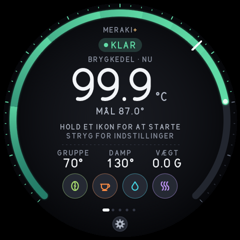
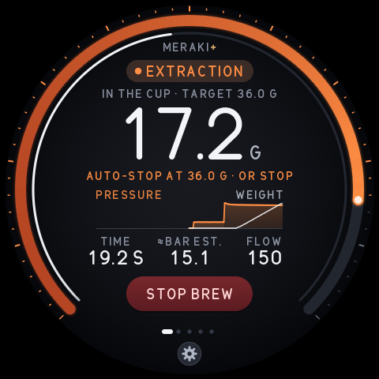
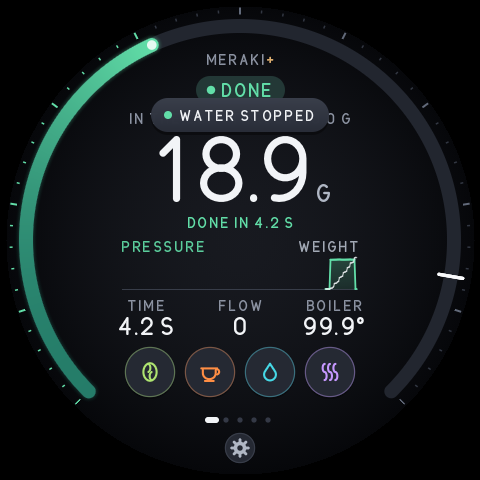
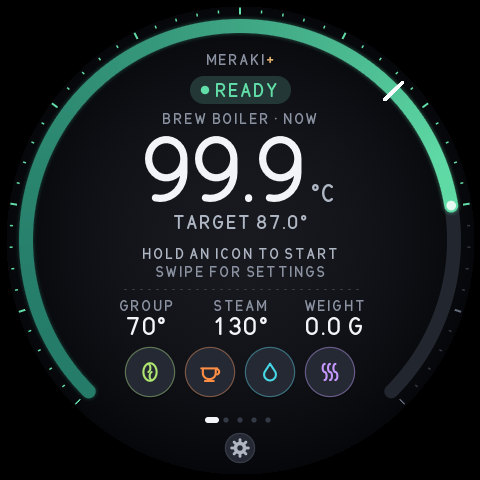
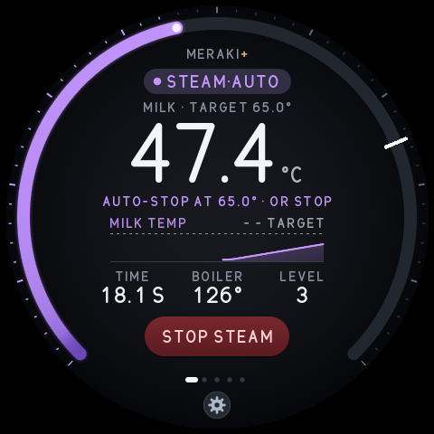
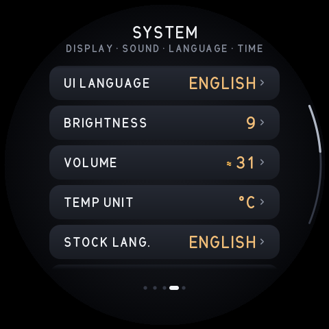
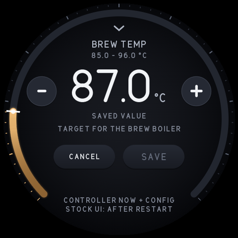
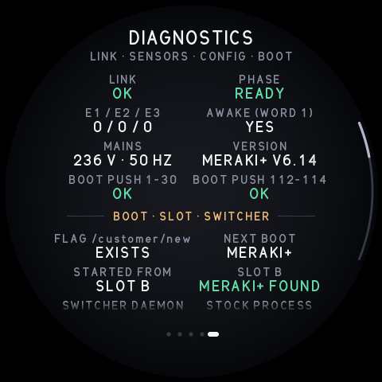

# Meraki+ — community-UI til MerakiTech-espressomaskinens runde skærm

[](https://github.com/thomasgrastein/merakitech-plus/actions/workflows/ci.yml)


<p align="center">
  
  
  
</p>

**Meraki+** er et open source-erstatnings-UI til den runde 480×480-touchskærm på
**MerakiTech Gen 1**-espressomaskinen (og muligvis Gen 2 — se [Krav](#krav)). Det kører i
skærmens *slot B* via producentens egen A/B-mekanisme, så den originale software i *slot A*
aldrig røres, og du kan altid komme tilbage til den med ét kald: `./revert.sh`.

> **English summary.** Meraki+ is an unofficial, community-built replacement UI for the round
> touch display of the MerakiTech Gen 1 (possibly Gen 2) espresso machine. It installs into the
> display's spare firmware slot B using the vendor's own A/B mechanism, never modifies the stock
> UI in slot A, and can be removed with one command. **Use entirely at your own risk** — read the
> disclaimer below. Install: `./install.sh --ip <display-ip>`; remove: `./revert.sh --ip <display-ip>`.
> The rest of this README is in Danish; the installer, its messages and the code comments in
> `tools/` are in English.

---

## ⚠️ Ansvarsfraskrivelse — læs før du gør noget

**Kort sagt: Hvis du installerer Meraki+, gør du det 100 % på egen risiko. Ingen garanti, intet
ansvar, ingen support-forpligtelse.** Læs hele afsnittet. Fortsæt kun, hvis du forstår og
accepterer det.

1. **Egen risiko, ingen garanti.** Softwaren leveres "SOM DEN ER" (*AS IS*) uden nogen form for
   garanti — hverken udtrykkelig eller underforstået — herunder (men ikke begrænset til) garanti
   for salgbarhed, egnethed til et bestemt formål, sikkerhed eller fejlfrihed. Se [LICENSE](LICENSE).
2. **Intet ansvar.** Forfatteren/forfatterne og bidragydere kan **under ingen omstændigheder**
   holdes ansvarlige for nogen skade — direkte, indirekte, hændelig eller følgeskade — på
   maskine, ejendom, data, personer eller andet, som følger af brug eller manglende mulighed for
   brug af dette projekt, uanset om skaden kunne forudses. I det omfang lovgivningen i dit land
   ikke tillader en sådan ansvarsbegrænsning, gælder den i videst muligt omfang.
3. **Garanti og reklamationsret.** Ændring af maskinens software **kan ugyldiggøre
   producentens garanti** og kan påvirke din reklamationsret. Overvej at vente, til garantien er
   udløbet, og fjern altid Meraki+ (`./revert.sh`) før service eller indlevering.
4. **Risiko for "brick" og datatab.** Meraki+ er udviklet til at være forsigtig (backup før
   hver ændring, md5-kontrol, atomiske filskift, ingen genstart, slot A røres aldrig) — men
   software har fejl, og hardware-varianter findes. En fejl kan i værste fald efterlade skærmen
   uden fungerende UI, ødelægge indstillinger eller kræve elektronisk genopretning (UART/flash).
   Ingen garanti for, at det kan lade sig gøre.
5. **Elektrisk sikkerhed — livsfare.** Espressomaskinen kører på **230 V netspænding** og har
   kedler under tryk og med kogende vand/damp. **Du behøver ikke åbne maskinen** for at bruge
   Meraki+ (installationen sker over netværket). Åbner du den alligevel (fx til fejlfinding via
   UART): **tag stikket ud og vent til den er kølet af og afladet**, og gør det kun, hvis du er
   kvalificeret. Arbejde på 230 V-udstyr kan være ulovligt for ikke-autoriserede i dit land.
6. **Ingen tilknytning.** Projektet er **ikke** tilknyttet, godkendt, sponsoreret eller støttet
   af **MerakiTech**, af producenten af skærm-modulet (Sanbon) eller af **Cisco Meraki** (det er
   et helt andet firma — navnet "Meraki+" henviser alene til kaffemaskinen). Alle varemærker og
   produktnavne tilhører deres respektive ejere og bruges kun for at beskrive, hvilket produkt
   softwaren er lavet til.
7. **Ingen producent-software i dette repo.** Repoet indeholder **kun** eget værk (kildekode,
   egne builds, simulator, dokumentation). Producentens firmware, binærer, biblioteker og scripts
   er **ikke** inkluderet, distribueres ikke og er **ikke** omfattet af projektets licens.
8. **Producentens opdateringer (OTA) er usignerede og kan overskrive Meraki+.** Maskinens
   vendor-OTA kan installere ny firmware i slot B og/eller ændre boot-flaget — dvs. erstatte
   Meraki+ eller skifte tilbage til/fra stock uden at spørge. Vil du have Meraki+ permanent
   (`--persist`), anbefales det at **blokere vendorens OTA-domæne** (`oss.sanbontft.com`) i din
   router/DNS. Det betyder også, at du ikke får producentens rettelser — dit valg, din risiko.
   Se [Sikkerhed og OTA](#sikkerhed-og-ota).
9. **Maskinens netværkssikkerhed er dårlig fra fabrikken.** Skærmen kører en **åben root-telnet
   uden adgangskode** på port 23 (det er sådan Meraki+ installeres — Meraki+ åbner den ikke, den
   er der i forvejen). Alle på dit netværk kan derfor få fuld kontrol over skærmen. **Sæt maskinen
   på et separat IoT-net/VLAN og bloker adgang udefra.** Meraki+ lukker ikke hullet.
10. **Reverse engineering og lovlighed.** Protokol-dokumentationen er lavet ved reverse
    engineering af en maskine, forfatteren ejer, med henblik på interoperabilitet. Om — og i
    hvilket omfang — det er lovligt, afhænger af lovgivningen i dit land (fx EU's
    software-direktiv art. 6 vs. andre jurisdiktioner). **Det er dit ansvar at overholde
    lovgivningen, hvor du bor**, og eventuelle licensvilkår, du har accepteret.
11. **Tryk- og vægtvisninger er estimater.** Tryk-tallet (≈bar · EST.) er et lineært estimat
    ud fra ét ankerpunkt, ikke en kalibreret måling. Brug det ikke til sikkerhedsvurderinger.
    Maskinens egen controller (MCU) står for alle sikkerhedsfunktioner; Meraki+ ændrer ikke dens
    firmware.

Ved at downloade, installere eller bruge Meraki+ bekræfter du, at du har læst og accepteret ovenstående.

---

## Indhold

- [Hvad er Meraki+?](#hvad-er-meraki)
- [Funktioner](#funktioner)
- [Krav](#krav)
- [Hurtig installation](#hurtig-installation)
- [Brug](#brug)
- [Fjern Meraki+ (revert)](#fjern-meraki-revert)
- [Sikkerhed og OTA](#sikkerhed-og-ota)
- [Fejlfinding / FAQ](#fejlfinding--faq)
- [Sådan virker det](#sådan-virker-det)
- [Skærmbilleder](#skærmbilleder)
- [Udvikling, bidrag og sikkerhedsfejl](#udvikling-bidrag-og-sikkerhedsfejl)
- [Licens og varemærker](#licens-og-varemærker)

## Hvad er Meraki+?

MerakiTech-maskinen har to computere: en **controller (MCU)**, der styrer kedler, pumpe, kværn og
vægt, og et **skærm-modul** (Linux, ARMv7), der viser UI'et og sender kommandoer til controlleren
over en seriel forbindelse. Meraki+ erstatter **kun skærmens UI-program**. Controllerens firmware
og alle dens sikkerhedsfunktioner er uændrede — Meraki+ taler den samme protokol som det originale
UI og sender kun kommandoer, som det originale UI også sender (dokumenteret og testet frame for
frame, se [docs/protocol.md](docs/protocol.md)).

Skærm-modulet har to "slots": **A** (`/customer`, det originale UI) og **B** (`/new_customer`,
beregnet til producentens opdateringer). Et flag-fil vælger, hvilken der starter. Meraki+ lægges i
**slot B** — slot A røres aldrig, så det originale UI er altid intakt at vende tilbage til.

## Funktioner

- **Touch 1:1 på den runde skærm** — designet til 480×480-cirklen: stor gauge, store tal,
  hold-for-start (650 ms) på KVÆRN / BRYG / VAND / DAMP, så intet starter ved et uheld.
- **Indstillings-paritet med stock** — bryg-temperatur, pre-infusion, auto-vægt, damp, varmt vand,
  lysstyrke, lyd, sprog, tid m.m. (24 config-rækker på 3 sider), med samme grænser som stock, gemt i
  stock-formatet (så stock-UI'et læser dem bagefter) og med backup før hver ændring.
- **Manuel STOP** for **vand, kværn og bryg** (og damp) — den røde knap under en aktivitet.
  Stop-kommandoerne er de samme som controllerens egne, med bekræftelse når controlleren melder stop.
- **Live bryg-visning** — vægt i koppen, tid, flow og et **tryk-estimat** (≈bar · EST.); rolig
  graf (median + EMA) og vægt med dødbånd, så tallene ikke flimrer.
- **Center-hold-gestus (valgfri, `--gesture`)** — hold én finger midt på stock-UI'ets skærm i
  5 sekunder for at skifte til Meraki+ uden genstart (virker fra næste opstart efter installationen).
  Tilbage: *Indstillinger → SYSTEM → SKIFT TIL ORIGINAL NU*.
- **Tænd/sluk-knappen** respekteres — men se [hardware-begrænsningen](#tændsluk-knappen-hardware-begrænsning).
- **Boot-valg i UI'et** — *SYSTEM → BOOT-UI* vælger, om maskinen starter Meraki+ eller originalen.
- **DIAGNOSE-side** — forbindelse, fejlkoder E1–E3, version, boot-slot, net-status, rå tællere.
- **Engelsk og dansk** (skift under *SYSTEM → UI-SPROG*).
- **Simulator + E2E-tests** — hele UI'et kan køres uden maskine mod en simuleret controller
  (`sim/`), og CI kører dem på hver ændring.

## Krav

| | |
|---|---|
| **Maskine** | MerakiTech **Gen 1** med den runde touchskærm (skærm-modul Sanbon SAT62091M, Linux 4.9). Udviklet og testet på én Gen 1. **Gen 2: ikke testet** — installeren tjekker et fingeraftryk og stopper uden at ændre noget, hvis skærmen ikke ligner den forventede. Rapportér gerne resultater i en issue. |
| **Netværk** | Maskinen på dit Wi-Fi (sat op i stock-appen/UI'et), og din computer på **samme lokalnet**. |
| **Computer** | macOS eller Linux (Windows: brug WSL) med `bash`, `python3` ≥ 3.8 og `git`. Intet andet. |
| **Maskinens IP-adresse** | Find den i din routers liste over enheder, eller lad installeren finde den med `--scan`. |
| **Til udvikling (valgfrit)** | [zig](https://ziglang.org/download/) 0.17 til at bygge fra kilde — se [CONTRIBUTING.md](CONTRIBUTING.md). |

## Hurtig installation

```sh
git clone https://github.com/thomasgrastein/merakitech-plus.git
cd merakitech-plus

./install.sh --scan                      # 1. find skærmen på dit net (eller kig i routeren)
./install.sh --ip 192.168.1.50 --dry-run # 2. se præcis hvad der vil ske — ændrer intet
./install.sh --ip 192.168.1.50           # 3. installér og start Meraki+ (ingen genstart)
```

(Erstat `192.168.1.50` med din skærms adresse.) **Sørg for, at maskinen står stille** — ingen bryg,
damp, kværn eller varmt vand — mens du installerer. Installeren spørger, før den ændrer noget.

**Hvad installeren gør, trin for trin:**

1. **Tjekker skærmen (kun læsning)** — fingeraftryk (A/B-layout, ARMv7, slot B monteret), hvad
   der kører, hvilken slot der starter ved boot, ledig plads.
2. **Henter og verificerer binæren** — fra din lokale `bin/` (git clone) eller GitHub, altid
   md5-tjekket mod den forventede værdi. Afviser alt andet.
3. **Tager backup én gang** — slot B's eksisterende program og `/customer/demo.sh` kopieres og
   md5-verificeres. Backups overskrives aldrig af senere kørsler.
4. **Installerer i slot B** — upload, md5-tjek, atomisk omdøbning på samme filsystem (ingen
   halve filer, heller ikke ved strømsvigt).
5. **Valgfrit** — `--gesture` (gestus-skifteren; tilføjer **én** linje i `demo.sh`) og
   `--persist` (sætter boot-flaget). Uden disse røres hverken `demo.sh` eller flaget.
6. **Aktiverer uden genstart** — enten via producentens egen watchdog (exec-reload), eller ved et
   "stop-først"-skift: det originale UI pauses, Meraki+ startes og verificeres, og først derefter
   stoppes originalen. Går noget galt, genoptages originalen automatisk.
7. **Verificerer** — det kørende program er slot B's binær med den rigtige md5, kører stadig efter
   5 s, og slot A er uændret. Til sidst skrives revert-kommandoen.

**Valgmuligheder:**

| | |
|---|---|
| `--ip ADDR` / `--scan` | skærmens adresse / find den automatisk (`--subnet 10.0.0.0/24` for andet net) |
| `--dry-run` | vis alle trin, ændr intet |
| `--persist` | start Meraki+ ved **hver** opstart (sætter boot-flaget `/customer/new`) |
| `--gesture` | installér center-hold-gestussen (stock → Meraki+ uden genstart) |
| `--no-activate` | installér, men start ikke Meraki+ nu |
| `--yes` | spørg ikke (til scripts) |
| `--verbose` | vis hver kommando, der sendes til skærmen |

Installeren er **idempotent**: kør den igen for at opdatere til en ny version eller for at starte
Meraki+ igen efter en genstart (uden `--persist` starter maskinen originalen ved opstart). En log
gemmes i `logs/`. Status uden ændringer: `python3 tools/merakiplus.py status --ip ADDR`.

<details>
<summary><b>Installation uden git (curl) — frarådes</b></summary>

```sh
curl -fsSL https://raw.githubusercontent.com/thomasgrastein/merakitech-plus/main/install.sh | bash -s -- --ip 192.168.1.50
```

Binærerne bliver stadig md5-tjekket, men selve installations-scriptet bliver det ikke, og du kan
ikke læse det, før det kører. **Brug hellere `git clone`**, læs scriptet, og kør `--dry-run` først.
`revert.sh` kræver en klon af repoet.
</details>

## Brug

| Hvad | Sådan |
|---|---|
| **Start en aktivitet** | **Hold** et af de fire ikoner (kværn · bryg · vand · damp) i ~0,7 s. Et kort tryk viser kun en hjælpetekst. |
| **Stop en aktivitet** | Tryk på den røde **STOP**-knap (*STOP VAND / STOP BRYG / STOP KVÆRN / STOP DAMP*). Grøn besked = controlleren har bekræftet stop. Gul/rød besked = prøv igen. Auto-stop ved målvægt virker som hos stock. |
| **Skift side** | Stryg vandret, eller tryk i venstre/højre kant. Sider: HJEM · BRYG · DAMP/VAND · SYSTEM · DIAGNOSE. Tandhjulet på HJEM åbner indstillingerne. |
| **Ændr en indstilling** | Tryk på rækken → `−`/`+` (hold for at gå hurtigt) → **GEM**. Stryg ned eller tryk på pilen øverst for at fortryde. |
| **Sprog** | *SYSTEM → UI-SPROG* (engelsk/dansk). Stock-UI'ets sprog sættes separat (*STOCK-SPROG*). |
| **Tilbage til originalen nu** | *SYSTEM → SKIFT TIL ORIGINAL NU* (ingen genstart). |
| **Til Meraki+ fra originalen** | Med `--gesture`: hold **én finger stille midt på skærmen i 5 s** og slip (aktiv fra første opstart efter installationen, fordi gestus-skifteren startes af `demo.sh`). Uden: kør `./install.sh --ip ADDR` igen. |
| **Hvad starter ved opstart** | *SYSTEM → BOOT-UI* (gælder fra næste opstart), eller `--persist` / `./revert.sh`. |

### Tryk-estimatet

Maskinen har ingen kalibreret tryksensor-værdi i protokollen. Meraki+ viser derfor tryk som et
**estimat**: det rå tal fra controlleren skaleres lineært, så pre-infusion-niveauet svarer til den
pre-infusion-tryk, der står i indstillingerne (standard 4 bar). Tallet er mærket *≈BAR · EST.*;
tryk på grafen for at se grundlaget. Brug det som tendens, ikke som måling. Detaljer:
[docs/calibration.md](docs/calibration.md).

### Tænd/sluk-knappen (hardware-begrænsning)

Meraki+ implementerer stock's sluk/tænd-sekvens byte for byte — men på den testede hardware når
softwaren aldrig at reagere på et langt tryk:

- **Holder du knappen ~0,8 s**, skærer skærm-modulets kernel/strømstyring (PMIC) selv strømmen.
  Det er et **strømsvigt for skærmen**, ikke en pæn nedlukning — helt som med det originale UI.
- **Når maskinen tændes igen, er det en kold opstart** (skærmen booter forfra).
- Når controlleren går i dvale, slukker den også for skærmens strøm (~8 ms efter sluk-kommandoen).
- En tilstand "slukket, men skærmen lever og kan nås over netværket" er derfor **ikke mulig** på
  denne hardware. Ingen data går tabt ved det (Meraki+ skriver kun filer atomisk), men vent med at
  slukke, mens du gemmer en indstilling.

Detaljer og beviser: [docs/power.md](docs/power.md).

## Fjern Meraki+ (revert)

```sh
./revert.sh --ip 192.168.1.50 --dry-run   # se hvad der vil ske
./revert.sh --ip 192.168.1.50             # fjern Meraki+ og start originalen (ingen genstart)
./revert.sh --ip 192.168.1.50 --purge     # ... og slet også backups/sprogfil/indstillings-backups
```

Revert skifter straks tilbage til det originale UI (stop-først), lægger `demo.sh` tilbage
(byte-identisk med backuppen), fjerner gestus-skifteren, lægger slot B's originale program tilbage
(eller efterlader slot B tom, hvis den var tom), og sætter boot-flaget tilbage, som det var før
Meraki+. Den kan køres så mange gange, du vil.

**Indstillinger:** ændringer, du har gemt i Meraki+, ligger i `config.json` i stock-formatet og
bliver ved med at gælde i det originale UI — det er meningen. Meraki+ tager en backup før hver
ændring i `/new_customer/ourui/cfgbak/` (slettes kun med `--purge`).

**Kan du ikke nå skærmen over netværket?** Tag stikket ud i 10 s og sæt det i igen. Uden
`--persist` starter maskinen det originale UI. Med `--persist`: se den manuelle procedure i
[docs/boot.md §5.2](docs/boot.md).

## Sikkerhed og OTA

- **Telnet:** skærm-modulet har fra fabrikken en åben root-shell (telnet, port 23, ingen
  adgangskode). Sæt maskinen på et **gæste-/IoT-net**, tillad ikke indgående forbindelser udefra,
  og overvej at begrænse port 23 til din egen computer i routeren. Det er en sårbarhed i
  producentens firmware — rapportér den til producenten, ikke til dette projekt.
- **Vendor-OTA:** producentens opdateringer hentes ukrypteret/usigneret og installeres i den slot,
  der *ikke* kører, hvorefter boot-flaget skiftes. Konsekvenser: en OTA kan **overskrive Meraki+ i
  slot B**, **fjerne gestus-linjen** i `demo.sh` eller **skifte boot-slot**. Vil du beholde Meraki+
  permanent, så bloker `oss.sanbontft.com` i din router/DNS (og evt. `pro.ip-api.com`, som
  stock-UI'et kontakter). Efter en OTA: kør `./install.sh` igen (og evt. `./revert.sh` først).
- **Meraki+ selv** åbner ingen nye netværksporte og kontakter ingen servere. Den eneste
  netværksfunktion er at bringe skærmens Wi-Fi op ved opstart fra slot B (samme konfiguration som
  stock bruger; adgangskoden logges aldrig).
- Fund en sikkerhedsfejl i Meraki+'s egen kode? Se [SECURITY.md](SECURITY.md).

## Fejlfinding / FAQ

<details><summary><b>"Cannot reach …:23"</b></summary>

Maskinen skal være tændt og på samme net. Tjek IP'en i routeren, prøv `./install.sh --scan`, og
tjek at din computer ikke er på et gæste-net, der isolerer enheder.
</details>

<details><summary><b>"This does not look like a MerakiTech/Sanbon display"</b></summary>

Fingeraftrykket passer ikke (anden hardware/firmware). Installeren har ikke ændret noget. Åbn en
issue med output fra `python3 tools/merakiplus.py status --ip ADDR` (fjern selv IP-adressen).
</details>

<details><summary><b>Skærmen viste originalen igen efter strømafbrydelse</b></summary>

Forventet uden `--persist`. Kør `./install.sh --ip ADDR` igen, brug gestussen (`--gesture`), eller
vælg *BOOT-UI = Meraki+* i Meraki+'s SYSTEM-side.
</details>

<details><summary><b>Meraki+ viser "OFFLINE" / ingen forbindelse til controlleren</b></summary>

Controlleren sover måske (efter dvale). Tryk kort på tænd-knappen. Forbliver den offline, så skift
til originalen (*SKIFT TIL ORIGINAL NU*) og se om den virker dér; åbn ellers en issue med et
billede af DIAGNOSE-siden.
</details>

<details><summary><b>En aktivitet vil ikke starte</b></summary>

Hold ikonet i ~0,7 s (et kort tryk starter ikke). Står der *UDEN FOR SPEC*, er en indstilling uden
for stock's tilladte interval — ret den under BRYG/DAMP·VAND.
</details>

<details><summary><b>Kan jeg ødelægge kaffemaskinen?</b></summary>

Meraki+ ændrer ikke controllerens firmware og sender kun de kommandoer, det originale UI også
sender (med samme grænser, CRC og bekræftelse). Risikoen ligger primært i skærm-modulets software
— se ansvarsfraskrivelsen. Garantier gives ikke.
</details>

<details><summary><b>Virker det på Gen 2?</b></summary>

Ukendt. Kør `--dry-run` — installeren stopper uden ændringer, hvis skærmen ikke genkendes. Del
gerne resultatet i en issue.
</details>

## Sådan virker det

```
 /customer/          slot A — originalt UI (demo_v9), røres ALDRIG af Meraki+
 /new_customer/      slot B — Meraki+ installeres som demo_v9 her
   ourui/boot/       backups (demo_v9.vendor, demo.sh.bak), state, gestus-skifter
 /customer/new       boot-flag: findes → slot B starter ved opstart (kun med --persist)
 /customer/test.sh   producentens watchdog: genstarter "demo_v9", hvis den forsvinder
```

Producentens watchdog tjekker kun, at en proces ved navn `demo_v9` kører. Meraki+ hedder derfor
`demo_v9` i slot B, og et nyt program kan aktiveres uden genstart. Den fulde beskrivelse (inkl.
gestus, watchdog-race og OTA-tabellen) står i [docs/boot.md](docs/boot.md).

| Dokument | Indhold |
|---|---|
| [docs/protocol.md](docs/protocol.md) | UART-protokollen skærm ↔ controller (frames, CRC, kommandoer) |
| [docs/registermap.md](docs/registermap.md) | Controllerens 129 register-ord |
| [docs/ui-guide.md](docs/ui-guide.md) | Sider, touch-zoner og indstillinger i Meraki+ |
| [docs/boot.md](docs/boot.md) | A/B-boot, watchdog, gestus-skifter, OTA, manuel revert |
| [docs/gesture.md](docs/gesture.md) | Center-hold-gestussen og grab-bypass |
| [docs/power.md](docs/power.md) | Tænd/sluk-knappen: verifikation og hardware-fund |
| [docs/calibration.md](docs/calibration.md) | Tryk-estimat, graf- og vægt-konditionering |
| [docs/dev/](docs/dev/) | Udviklernoter (fuld UI-spec m. changelog, paritets-analyse) |
| [sim/README.md](sim/README.md) | Simulatoren og E2E-testene |

## Skærmbilleder

Fra simulatoren (samme kode som på maskinen):

| | | |
|---|---|---|
|  |  |  |
| HJEM, klar (engelsk) | Damp | SYSTEM-indstillinger |
|  |  |  |
| Bryg-temperatur | DIAGNOSE | HJEM (dansk) |

## Udvikling, bidrag og sikkerhedsfejl

- Byg, test og simulér: [CONTRIBUTING.md](CONTRIBUTING.md) (`./build.sh`, `python3 sim/selftest.py`,
  `python3 sim/run_e2e.py --all --quick --parallel 4`, `python3 tests/test_installer.py`).
- Ændringer: [CHANGELOG.md](CHANGELOG.md). Adfærdskodeks: [CODE_OF_CONDUCT.md](CODE_OF_CONDUCT.md).
- Sikkerhedsfejl: **ikke** som offentlig issue — se [SECURITY.md](SECURITY.md).
- De leverede binærer og deres md5: [bin/README.md](bin/README.md).

## Licens og varemærker

Projektets egen kode og dokumentation er udgivet under [MIT-licensen](LICENSE). Licensen omfatter
**ikke** producentens firmware eller software, som hverken er inkluderet eller licenseret her.
"MerakiTech" og andre nævnte navne er varemærker tilhørende deres respektive ejere; "Cisco Meraki"
er et varemærke tilhørende Cisco Systems, Inc. og har intet med dette projekt at gøre.
