# UX audit of v6.16 and the v6.17 redesign

**Scope.** A critical pass over the whole Meraki+ UI as of v6.16 (commit `e406772`), answering five
questions from the machine's owner plus a list of critique angles, followed by the information
architecture that v6.17 implements. Everything here concerns what is *shown* and how you *get to
it*: no frame, no guard, no control logic changed between v6.16 and v6.17.

**Method.** The v6.16 source (`src/merakiplus.c` at `e406772`; line numbers below refer to that
commit), the 90 rendered preview screens per language, and the string table (449 ids × EN/DA).
Numbers under "after" are measured by the v6.17 self-test (`--selftest`, section *v6.17 IA
consolidation*) or by the E2E scenarios named next to them.

**Not verified:** on a real machine. The screens are rendered by the same code that runs on the
device, and the navigation is exercised by real touch events in the simulator, but nobody has yet
stood in front of v6.17 with wet hands. Arm's-length legibility in particular is argued from font
sizes and contrast ratios, not observed.

---

## 1. The short version

| | v6.16 | v6.17 |
|---|---|---|
| Top-level pages | 5 in a carousel: HOME · BREW · STEAM·WATER · SYSTEM · DIAGNOSTICS | 1 root (HOME); everything else is a sheet opened from the thing it belongs to |
| Where a feature's settings live | three lists that follow the *spec's tiers* | on that feature's own page, behind its icon |
| Settings rows | 29 + 2 actions in three flat lists (9 / 5 / 17) | 12 on four feature pages (2 / 6 / 2 / 2) + 16 and 2 actions in four SYSTEM sections; SYSTEM closed = 5 rows, no scrolling |
| What the start icons tell you | nothing — four unlabeled icons | each carries its target: `18.5 G` · `36 G` · `40 G` · `65°` |
| Tap on a start icon | toast "HOLD THE BUTTON TO START" (a dead end) | opens the feature's page: live line, its settings, a labelled **HOLD TO START** |
| Ways to move between pages | swipe, two invisible edge zones, a gear that only leads to BREW, page dots that are not buttons | tap what you see to open; the chevron at the top (or swipe right) to go back |
| Taps from HOME to an editor | 2 taps **plus** up to 2 page swipes and up to 3 screens of scrolling | 2 (feature) or 3 (SYSTEM), worst case 3 short drags |
| STOP button | 160 × 44 px, dark red, 1.9 : 1 against the background | 216 × 54 px (+66 %), 4.0 : 1 against the background, white text ≥ 4.6 : 1 |
| Editor: text besides the value | title, range, status, note, two footer lines | title, range, note — status only when it says something |
| User-facing strings (EN) | 337 ids, 5 811 characters | 326 ids, 5 184 characters (−11 %) — with four new pages |
| DIAGNOSTICS | a top-level page, one swipe from HOME | behind SYSTEM, or one tap on HOME's error / offline hint |

| v6.16 | v6.17 |
|---|---|
| 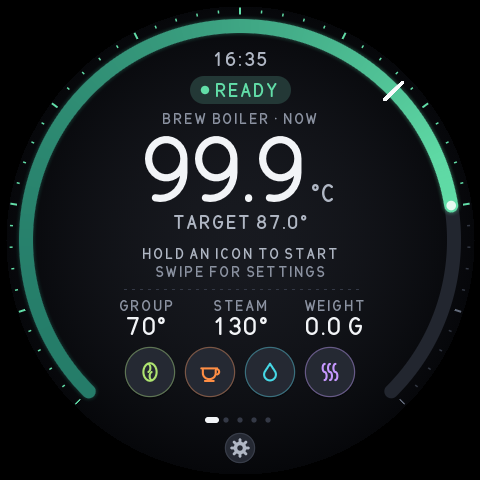 | 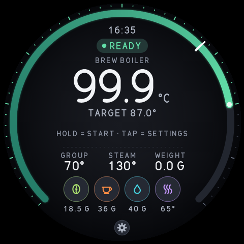 |
| 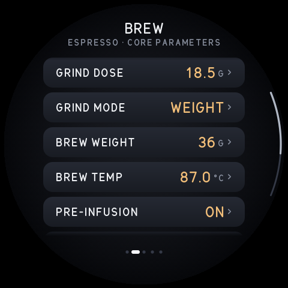 | 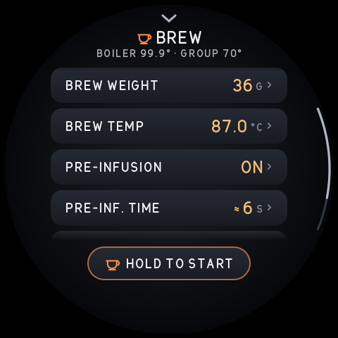 |
| 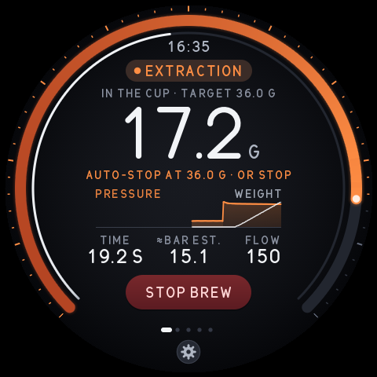 | 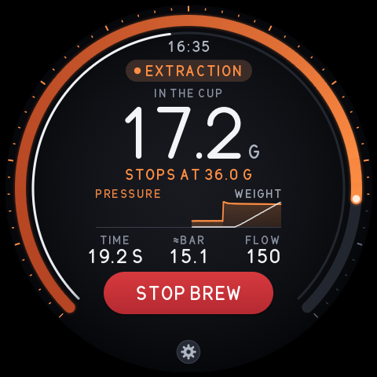 |

---

## 2. The five questions

### Q1 — Is there unnecessary text?

**Yes, and most of it describes the implementation rather than the coffee.**

* **Every editor carried two footer lines** — `CONTROLLER NOW + CONFIG` / `STOCK UI: AFTER RESTART`,
  or a file path (`MERAKI+ ONLY · merakiplus/lang`), or `SHOWN FROM CONFIG.JSON` / `EDITOR ONLY IN
  STOCK UI` (`detail_text`, line 4724; drawn at 4749). That is 29 editors explaining where the bytes
  go. A locked row said "locked" five ways: `CANNOT BE CHANGED HERE`, `LOCKED`, `LOCKED · SET IT IN
  THE STOCK UI` and both footers.

  | v6.16 | v6.17 |
  |---|---|
  | 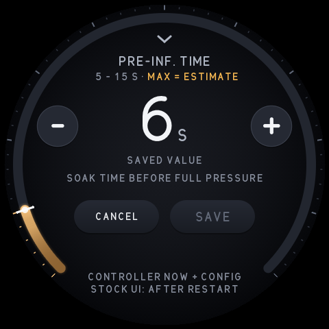 |  |
* **The status line said `SAVED VALUE`** whenever nothing had been changed (line 4782) — a label for
  the absence of news.
* **The target was stated twice during an activity, plus an instruction to use the button below
  it:** `IN THE CUP · TARGET 36.0 G` over the number and `AUTO-STOP AT 36.0 G · OR STOP` under it
  (lines 4204–4206), on top of the gauge marker. The sub-line was so long that it had to be drawn in
  the smallest font (line 4527).
* **`≈BAR EST.`** says "estimate" twice (the ≈ and the EST.), on every brew.
* **Six notes started with `CONFIG ONLY ·`**, and one mentioned `CMD8`.
* **Page sub-lines** (`ESPRESSO · CORE PARAMETERS`, `DISPLAY · SOUND · LANGUAGE · TIME`, `LINK ·
  SENSORS · CONFIG · BOOT`) were tables of contents for a page you were already looking at.
* **HOME spent two lines on instructions** (`HOLD AN ICON TO START` / `SWIPE FOR SETTINGS`) because
  neither the icons nor the navigation explained themselves — text standing in for an affordance.
* **Toasts** told you about config files: `SAVED · CONTROLLER + CONFIG`, `SAVED · STOCK UI: AFTER
  RESTART`.
* **DIAGNOSTICS** is verbose by nature, but two of its lines were documentation (`ESTIMATE · PUMP
  SIDE · NOT AT THE PUCK`, `> 20 BAR = PULSE · RAW: GRAPH PILL`).

**v6.17:** all of the above is removed or shortened (the full list is in §6). What survived is what
changes what you do: `STOPS AT 36.0 G`, `RELEASE THE WAND TO STOP`, the reason a start is blocked,
the consequence of switching to the stock UI. The self-test now fails if any user-facing string
contains `CONFIG ONLY`, `CONFIG.JSON`, `CMD8`, `· OR STOP` or `EST.`, and if anything is drawn
below an editor's buttons.

### Q2 — Does the overall experience make sense?

**The live view does; the model around it did not.**

What works, and was kept untouched: HOME as a single glanceable instrument — one big number, a
colour per phase, the gauge, the chart. During a brew it is a good screen.

What did not make sense:

* **The pages followed the parity spec, not the user.** `SET[].tier` (line 2056 ff.) put GRIND DOSE
  on a page called BREW, HOT WATER under "STEAM · WATER", and the pre-heat schedule at rows 13–16 of
  a 17-row SYSTEM list — 1 016 px of content in a 308 px window. To change the milk temperature you
  went gear → swipe → row; to set the pre-heat time, gear → swipe twice → scroll two screens → row.
* **HOME's hero is the brew boiler temperature**, which is the right resting number, but nothing on
  HOME said what the four buttons would *do*. The answer (dose, yield, amount, temperature) was two
  pages away.
* **Settings rows that are not settings.** `WATER SENSOR` was a read-only temperature dressed as a
  row; `PAUSE TIME` is locked and has no effect; five rows only matter to the stock UI. They sat
  between the things you actually tune.
* **Nothing but HOME could stop the machine.** If an activity started while a list was open (lever,
  wand, schedule), the UI stayed on the list: no STOP, no weight, no chart.

At arm's length the weakest parts were the F_XS (11 px) sub-line during activities and the STOP
button (see Q3 and §3).

**v6.17:** HOME is the root and the *only* live view. Each feature has a page that is its setup;
SYSTEM is the machine's setup. A feature page never stays on screen while something runs — the UI
slides back to HOME, where STOP is (E2E `activity_takes_home`).

### Q3 — Press-and-hold to start while all configuration is hidden: discoverable? coherent?

**Neither.**

* **Not discoverable.** A hold is an invisible gesture. v6.16 taught it with a line of text and, if
  you tapped instead, a toast (`activate`, line 3913). The progress ring only appears once you are
  already holding.
* **Not coherent.** Holding commits you to parameters you cannot see. The only place the target
  appeared before the start was the sub-line *during* the 650 ms hold (`HOLD · BREW 36.0 G`), i.e.
  when it is too late to reconsider calmly. And the tap — the gesture everyone tries first — did
  nothing useful.

**Should settings be reachable from the activity itself? Yes — from the activity's *button*.**
v6.17 gives the two gestures two meanings on the same icon:

* **Tap = open.** The feature's page: what is true right now (`BOILER 92.4° · GROUP 70°`), what
  will happen (its settings, editable in place), and a labelled **HOLD TO START** pill that fills
  as you hold. A first-time user who taps lands on a screen that explains the hold by showing it.
* **Hold = start**, exactly as before, for people who know. The icon now carries its target
  underneath, so the hold is no longer blind.

The pill sends byte for byte the same frames as the icon (self-test: all four activities), and a
blocked start is explained on the page itself, permanently, not only by a toast: the live line turns
amber with the reason (`NO CONNECTION`, `GRIND = TIME · USE STOCK UI`, `CONFIG OUT OF SPEC · FIX
FIRST`).

| tap → page | hold on the page | blocked |
|---|---|---|
| 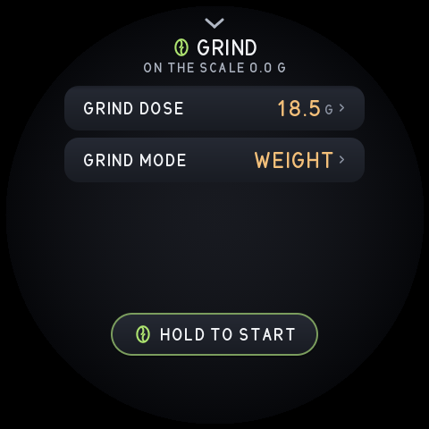 | 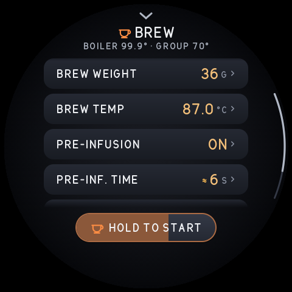 | 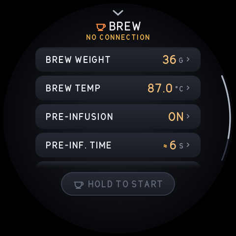 |

*During* an activity there is nothing to configure — the controller refuses writes then, and that
guard is unchanged — so the live view stays free of settings.

### Q4 — Why so many settings pages? Can it be consolidated?

**Because the lists mirrored `config.json`.** The three lists were the spec's tier 1 split in two,
plus tiers 2–3 and Meraki+'s own rows appended in the order they were written. DIAGNOSTICS was a
fifth page because it was built first.

The 29 parameters fall into three groups that the old lists mixed:

| Group | Rows | v6.17 home |
|---|---|---|
| What an activity uses | 12 | that activity's page |
| How the machine itself behaves (display, clock, schedule) | 10 | SYSTEM › DISPLAY / CLOCK / SCHEDULE |
| What only the stock UI reads, and the two actions that lead to it | 6 + 2 | SYSTEM › STOCK UI |
| A measured value | 1 | the WATER page's live line |

**v6.17:** yes. No parameter was dropped (the self-test walks every one of them by taps), but none
of them is on a "settings page" any more: 12 sit with their feature, and SYSTEM shows five rows
until you open a section.

| SYSTEM, v6.16 (17 rows) | SYSTEM, v6.17 (closed) | a section open |
|---|---|---|
| 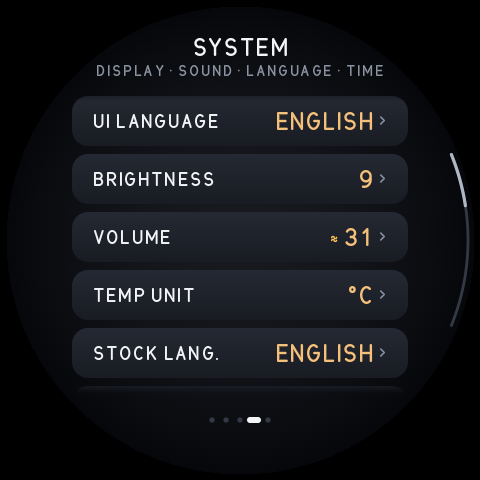 | 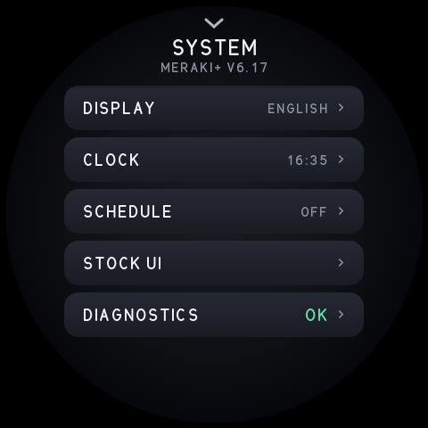 | 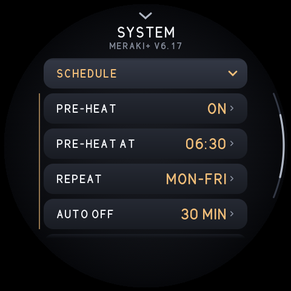 |

### Q5 — One page per feature with its settings inline: better?

**Yes, adopted — with one deliberate deviation: the *live activity* stays on HOME.**

For:

* It answers Q3 and Q4 with one move: the settings are where the action is, and the lists go away.
* It matches how the machine is used: "I am about to steam" → everything about steam.
* It is the model the icons already imply.

Considered and rejected:

* **Feature pages in a carousel** (HOME · GRIND · BREW · WATER · STEAM · SYSTEM). Six pages instead
  of five and the same blind swiping; it would have increased the page count the question complains
  about.
* **One SETTINGS page with seven accordion sections.** Fewer pages, but the settings are again
  somewhere other than the feature.
* **Moving the live gauge onto the feature page.** Activities also start from the machine (lever,
  wand, the pre-heat alarm). With one live view, whatever starts, however it starts, the same screen
  shows it and the same button stops it. So a feature page is *setup + start*, HOME is *now*.
* **Expandable settings on HOME itself.** HOME is the one screen that must stay readable from a
  metre away.

"Inline" is used in two forms: a feature page lists its 2–6 settings directly (no extra step), and
SYSTEM, which has 18 rows, uses expandable sections — one open at a time, the opened header moves
to the top, and a closed header shows a summary (`DISPLAY  ENGLISH`, `CLOCK  16:35`, `SCHEDULE
06:30`) so you often do not need to open it at all.

---

## 3. The additional angles

| Angle | v6.16 finding | v6.17 |
|---|---|---|
| **Hold vs tap** | Tap on an icon = a toast. | Tap = the feature's page, hold = start; a tap on HOLD TO START says `KEEP HOLDING TO START`. |
| **Gestures** | Swipe was the *primary* navigation and invisible; the edge zones (70 px, lines 3884/3890) had no visual at all. | No carousel, no edge zones. One gesture family, always a shortcut for a visible control: swipe right = back; pull the header down = close. HOME reacts to no swipe. |
| **Press states / latency** | Present on rows, buttons, the gear; ripple on every target. Nothing to fix. | Same, plus: the page header shows a press state; HOLD TO START fills left to right. |
| **Error / offline / asleep** | The error line said `CODE E2 · SEE DIAGNOSTICS` — an instruction to navigate three pages. | The line is the button: `CODE E2 · TAP FOR DETAILS` opens DIAGNOSTICS and its chevron returns to HOME. SYSTEM's DIAGNOSTICS row shows `OK` / the code / `DOWN`. Asleep is unchanged (`WAKING UP…`). |
| **Round-screen space** | The list pages ended at y 394 with dots at 420 and nothing below; HOME's bottom was dots plus a small gear. | Feature pages use the bottom for HOLD TO START; HOME's bottom carries the icon targets. SYSTEM's bottom 80 px are still empty (see §7). |
| **Icon / label consistency** | The four activity icons appeared only on HOME; pages were named differently (`BREW` contained grind). | A feature page's title is its HOME icon in its colour plus its name; the pill repeats the icon. |
| **DIAGNOSTICS top-level?** | One swipe from HOME, with the same visual weight as BREW. | Advanced: behind SYSTEM's last row. The one case where a user needs it — a fault — gets a direct entry from HOME. |
| **Clock / schedule / auto-off** | Clock on HOME (good). Schedule rows at the bottom of a 17-row list. | Clock stays on HOME; the *next* pre-heat stays on HOME only when one is planned; their settings are SYSTEM › CLOCK and › SCHEDULE. They are machine-wide, so not on a feature page. |
| **`AUTO-STOP AT x G · OR STOP` + `EST`** | See Q1. | `STOPS AT 36.0 G`, once, in F_S (14 px instead of 11). `≈BAR`. The estimate's caveats live in `docs/calibration.md`; tapping the chart still shows the basis. |
| **Language toggle** | Row 1 of SYSTEM (good), reached by gear → swipe → swipe. | Gear → DISPLAY → UI LANGUAGE. The closed DISPLAY header shows the active language's own name (`ENGLISH` / `DANSK`), so it is findable in a language you cannot read. |
| **Stepper − / +** | Visible. Hold-to-repeat with acceleration was undiscoverable. | The freed status line says `HOLD - OR + TO GO FAST` — only on editors with ≥ 20 steps and only while the value is untouched. |
| **STOP prominence** | 160 × 44 px in rgb(120,40,44) (line 4582): 1.9 : 1 against the background — it read as a disabled button. Two buttons shrank to 136 px and F_XS. | 216 × 54 px, bright red, white F_M text; two buttons 152 px in F_S. It is the largest touch target on HOME while something runs (232 × 60 px). The page dots under it are gone. |
| **Navigation consistency** | Four mechanisms, none complete: the gear went only to BREW, the dots were not tappable, DIAGNOSTICS had no way "back" but swiping on. | Open by tapping, close with the chevron — the same glyph, in the same place, on pages and editors. |
| **Cognitive load of 40+ rows** | 31 rows in three lists, the largest 3.3 screens long. | At most 6 rows on a feature page (4 in view); SYSTEM 5 rows closed, at most 8 in an open section. |

---

## 4. Problems, ranked by impact

1. **A blind, unexplained start gesture** (Q3). Affects every use of the machine. → icon targets,
   tap-opens-page, labelled HOLD TO START.
2. **STOP did not look like the primary action.** A safety-relevant control with 1.9 : 1 contrast.
   → size, colour, contrast (self-test: ≥ 4.5 : 1 text, ≥ 3 : 1 against the background).

   | v6.16 (brew + latched steam) | v6.17 |
   |---|---|
   | 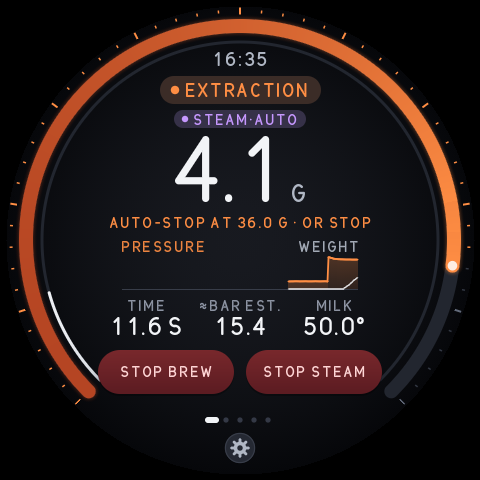 | 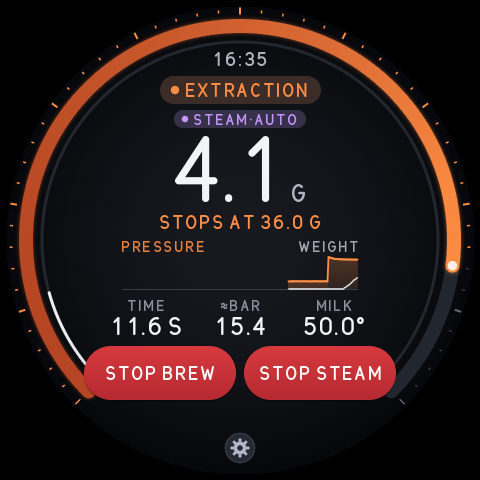 |

3. **STOP and the live view were absent everywhere but HOME.** → feature pages yield to HOME when
   anything runs.
4. **Settings organised by spec tier** (Q4): every adjustment cost page swipes and scrolling.
   → per-feature pages; SYSTEM in sections.
5. **Navigation by hidden gestures** with four inconsistent mechanisms. → one model.
6. **Implementation text on every editor and in toasts** (Q1). → removed.
7. **Duplicate statements during activities** forcing the smallest font. → one statement, larger.
8. **The error hint pointed at a page instead of opening it.** → tappable.

   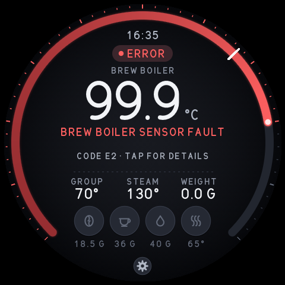

9. **Rows that are not settings** among the settings. → live line / STOCK UI section.
10. **DIAGNOSTICS as a peer of BREW.** → behind SYSTEM.

---

## 5. The information architecture (implemented in v6.17)

```
HOME  — live state of the machine / of whatever runs; STOP while it runs
 ├─ icon, tap ──► GRIND   live: ON THE SCALE 0.0 G        rows: GRIND DOSE · GRIND MODE                    [HOLD TO START]
 ├─ icon, tap ──► BREW    live: BOILER 92.4° · GROUP 70°  rows: BREW WEIGHT · BREW TEMP · PRE-INFUSION ·
 │                                                              PRE-INF. TIME · PRE-INF. PRESSURE · GROUP HEAD [HOLD TO START]
 ├─ icon, tap ──► WATER   live: WATER 99.9°               rows: HOT WATER · WATER MODE                      [HOLD TO START]
 ├─ icon, tap ──► STEAM   live: BOILER 130° · MILK 22.6°  rows: MILK TEMP · STEAM LEVEL                     [HOLD TO START]
 ├─ icon, hold ─► starts (unchanged)
 ├─ gear ───────► SYSTEM  MERAKI+ V6.17
 │                 ├─ DISPLAY   ENGLISH   UI LANGUAGE · BRIGHTNESS · TEMP UNIT
 │                 ├─ CLOCK     16:35     TIME FORMAT · DAYLIGHT SAVING · TIME ZONE
 │                 ├─ SCHEDULE  06:30     PRE-HEAT · PRE-HEAT AT · REPEAT · AUTO OFF
 │                 ├─ STOCK UI            BOOT UI · SWITCH TO ORIGINAL NOW · VOLUME · STOCK LANG. ·
 │                 │                      WATER SHORTCUT · CLEANING REMINDER · AUTO TIME · PAUSE TIME
 │                 └─ DIAGNOSTICS  OK ──► DIAGNOSTICS (advanced)
 └─ error / offline hint, tap ──► DIAGNOSTICS
```

Rules:

* **Open** by tapping the thing; **close** with the chevron at the top (the whole header is the
  target), by swiping right, or — on pages — by pulling the header down. Editors also close by
  swiping down, as before.
* **A row opens its editor**; SAVE or CANCEL returns to the page it was opened from.
* **A feature page is never on screen while an activity runs.** Started from the page, from the
  machine or by the wand: the UI is on HOME. An open editor stays until it is closed (then HOME);
  SYSTEM and DIAGNOSTICS stay, because you went there on purpose.
* **SYSTEM opens closed**, at the top, every time you come from HOME.
* In the code the pages and their rows are two tables (`FEAT_ROWS`, `SEC_ROWS`); hit-testing,
  drawing, the simulator's `layout` hook and the self-test all read the same row model.

Functional parity (all unchanged in behaviour, all re-tested): every parameter and its limits,
SAVE's write-then-persist order, hold-to-start and its guards, STOP for grind / brew / water /
steam, the centre gesture and the switcher, the power button, the pre-heat schedule and auto-off,
clock / 24 h / DST, the graph reset, the pressure estimate, the weight deadband, the display
conditioning and the RAW toggle.

---

## 6. Text removed or shortened

| Where | v6.16 | v6.17 |
|---|---|---|
| Editor footers (all 29) | two lines, e.g. `CONTROLLER NOW + CONFIG` / `STOCK UI: AFTER RESTART` | — |
| Editor status, unchanged value | `SAVED VALUE` · `SAVED CHOICE` · `SENSOR · LIVE` · `LOCKED` | — (or the hold hint) |
| HOME label | `BREW BOILER · NOW` | `BREW BOILER` |
| HOME hints | `HOLD AN ICON TO START` + `SWIPE FOR SETTINGS` | `HOLD = START · TAP = SETTINGS` |
| Activity label | `IN THE CUP · TARGET 36.0 G` · `DOSE · TARGET 18.5 G` · `MILK · TARGET 65.0°` | `IN THE CUP` · `DOSE` · `MILK` |
| Activity sub-line | `AUTO-STOP AT 36.0 G · OR STOP` | `STOPS AT 36.0 G` |
| Wand | `MILK PROBE · NO TARGET` / `NO AUTO-STOP · RELEASE WAND` | `MILK PROBE` / `RELEASE THE WAND TO STOP` |
| Stat label | `≈BAR EST.` | `≈BAR` |
| Error / offline hint | `CODE E2 · SEE DIAGNOSTICS` · `DETAILS IN DIAGNOSTICS` | `CODE E2 · TAP FOR DETAILS` · `TAP FOR DETAILS` |
| Toasts | `SAVED · CONTROLLER + CONFIG` · `SAVED · STOCK UI: AFTER RESTART` · `SAVED · MERAKI+ SCHEDULE` | `SAVED · ACTIVE NOW` · `SAVED` · `SCHEDULE SAVED` |
| Notes | six starting with `CONFIG ONLY ·`; `LOCAL TIME · SENT AS THE CMD8 ALARM`; `LIVE PREVIEW · 0 OMITTED (DARK SCREEN)` | `STOCK UI SOUND`, …; `LOCAL TIME`; `LIVE PREVIEW` |
| Page sub-lines | four | — (a feature page has a live line instead) |
| SYSTEM caption | `STARTUP · UI CHOICE` | the STOCK UI section |
| DIAGNOSTICS | two caveat lines under the pressure estimate | moved to `docs/calibration.md` |

Added: `HOLD TO START`, `HOLD - OR + TO GO FAST`, four section names, four live-line formats,
`MILK`. Net: 25 string ids removed, 11 added.

---

## 7. What v6.17 does not solve

* **Unverified on hardware** (see the top). The first thing to check on a machine: whether the icon
  targets (11 px) are readable at the distance you stand while the grinder runs, and whether
  swipe-right-to-go-back fires by accident when scrolling with a wet thumb. Both are guarded in the
  self-test geometrically, not ergonomically.
* **A page left open stays open.** If you walk away from SYSTEM, the machine shows a settings list
  until someone closes it (or something starts running on a feature page). Returning to HOME after
  a minute without touch would restore "always glanceable", but interacts with the simulator's
  page hooks and was left out of a display-only round.
* **The editor's lower third is now empty.** The footers are gone and the buttons were not moved
  (their geometry is covered by many tests). It reads as calm rather than broken, but the layout
  was designed around text that is no longer there.
* **GRIND, WATER and STEAM pages have two rows** and a lot of air between them and HOLD TO START.
  Consistent placement was preferred over centring.
* **SYSTEM's bottom 80 px are unused** when the sections are closed.
* **DIAGNOSTICS is still 4.7 screens long.** It moved; it was not redesigned.
* **Danish strings were written by the same pass** and checked for fit, not by a second reader.
